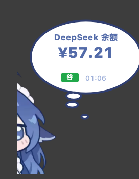
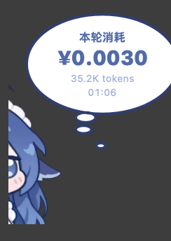
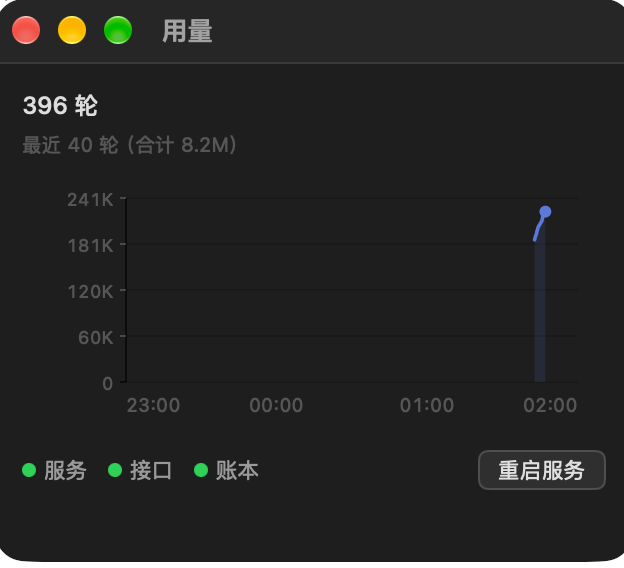

# WhaleFloat

> **DSH 的 macOS 启动器**，顺带养了一只盯着余额的小鲸鱼。


---

## 一、安装部署

### 方式一：手动（三步）

```bash
# 1. 下载 dmg（或从 Release 页面点下载）
curl -L -o /tmp/WhaleFloat.dmg \
  https://github.com/tigriyang/DeepSeek-Balance-Whale-Widget/releases/latest/download/WhaleFloat.dmg

# 2. 挂载并拷进应用程序目录
hdiutil attach /tmp/WhaleFloat.dmg -nobrowse
cp -R "/Volumes/小鲸鱼/WhaleFloat.app" /Applications/
hdiutil detach "/Volumes/小鲸鱼"

# 3. 启动（首次会自己装 launchd 自启）
open -a WhaleFloat
```

或者更简单：双击 dmg，把「小鲸鱼」拖进「应用程序」。

> 这个链接永远指向最新版：发版脚本会同时上传一份固定名 `WhaleFloat.dmg`。
> 想装某个特定版本，去 [Releases](../../releases) 页挑。

### 首次打开会被 Gatekeeper 拦

这个应用没有 Apple 开发者证书，双击会提示「无法验证开发者」。

解决办法：在「应用程序」里右键点击 → 打开，再点一次「打开」。
之后就不会再拦了。

（也可以去「系统设置 → 隐私与安全性」底部点「仍要打开」。）

### 方式二：交给 AI 全自动部署

把下面这段整段复制给任意有文件读写和命令执行能力的 AI（Claude Code / Cursor / DSH 等）：

````markdown
帮我在这台 macOS 上安装 WhaleFloat（DSH 的启动器应用），按以下步骤执行，
每步做完确认结果再继续，遇到问题停下来说明原因：

1. 下载最新安装包：
   curl -L -o /tmp/WhaleFloat.dmg \
     https://github.com/tigriyang/DeepSeek-Balance-Whale-Widget/releases/latest/download/WhaleFloat.dmg

2. 挂载：hdiutil attach /tmp/WhaleFloat.dmg -nobrowse
   记下挂载点（通常是 /Volumes/小鲸鱼）

3. 把 WhaleFloat.app 从挂载点复制到 /Applications/（已存在就替换）

4. 卸载镜像并清理：hdiutil detach <挂载点>; rm -f /tmp/WhaleFloat.dmg

5. 去掉隔离属性（否则会提示「无法验证开发者」）：
   xattr -dr com.apple.quarantine /Applications/WhaleFloat.app

6. 启动它：open -a WhaleFloat
   （首次运行它会自己安装 launchd 自启配置，并静默装好配套插件）

7. 验证：
   · ps -axo command= | grep WhaleFloat  → 应有进程
   · 菜单栏应出现一个小鱼图标
   · ls ~/Library/LaunchAgents/ai.dsh.whalefloat.plist → 应存在

8. 如果 DSH 尚未安装，提醒我，不要擅自安装。

注意：不要用 sudo，全程在用户目录下操作。
````

### 升级

直接下载新 dmg，覆盖 `/Applications` 里那份，退出再打开即可。**不需要先卸载。**

覆盖安装会保留：设置、导入的角色与音效、自定义动画、拖图缓存、账本、自启配置。
首次启动会比对并自动更新配套插件，然后冒一句「更新到 <版本>」——这是覆盖安装唯一的可见回执。

如果覆盖后启动异常，再走一次「卸载 → 重装」；那是干净重装，会清掉下面这些数据。

两个升级时会遇到的小事：

- 屏幕录制权限按签名身份记账：升级后如果身份变了且权限失效，会自动清掉旧条目并提示重新添加（见 3.4）。
- 配套插件在启动时自动比对更新；DSH 当时没在跑的话，下次启动 DSH 才生效。
- 签名身份变了的话，首次启动会清掉旧 TCC 条目并提示重新授权；同一张开发证书重签不会。

### 卸载

四条路，清理范围不一样：

| 方式 | 应用 | 自启 | 插件（引用/源码/副本） | 设置·素材·动画·拖图缓存 | 账本与状态 | 缓存与日志 |
|---|---|---|---|---|---|---|
| 菜单「高级设置 → 卸载 WhaleFloat…」 | 进废纸篓 | ✓ | ✓ | ✓ | ✓ | ✓ |
| `bash uninstall.sh` | ✓ | ✓ | ✓ | ✓ | ✓ | ✓ |
| `bash uninstall.sh --keep-data` | ✓ | ✓ | ✓ | 保留 | ✓ | ✓ |
| 在 Finder 里拖进废纸篓 | ✓ | ✗ | ✗ | ✗ | ✗ | ✗ |

推荐前两种。`install.sh uninstall` 现在直接转给 `uninstall.sh`，不再维护第二套清理范围。

### 命令行

```bash
open -a WhaleFloat --args --analysis   # 启动并直接打开用量窗口
/Applications/WhaleFloat.app/Contents/MacOS/WhaleFloat --quit   # 让在跑的那份退出
```

`--quit` 走的是正常的 terminate 流程，设置和窗口位置会被保存。

---
## 二、功能
初次安装时，随包会携带一个 whalefloat-helper 插件，后台自动注册安装，用来取得 DSH 会话里的信息。

### 0.2.0 新的三件事

- **whale-study**：把截图拖到小鲸鱼身上，开一轮新对话，让它看图解题。
- **动画**：往动画目录丢一张 GIF 就能播，什么时候播可以在菜单里选。
- **floatcompany**：你连续忙久了，气泡里会说一句「老大加油」。

### 2.1 快捷方式，启动 DSH-web

点击状态栏上的图标打开dsh-web界面


别的情形交给随包内置的启动器脚本：

端口被别的程序占了，它把原因弹给你，不静默失败。重复点击直接忽略，不会起出两个实例。

脚本随包发布，不依赖工作区路径。换台机器、挪过目录都不会失效。


### 2.2 桌面桌宠

| 动作 | 反应 |
|---|---|
| 单击 | 冒一下余额气泡 |
| 双击 | 摸摸头，压扁拉宽加音效 |
| 拖动 | 换位置；靠近屏幕边缘自动吸附并翻转朝向 |
| 拖入图片 | 开新会话看图解题（见 2.6） |
| 连续码字 20 分钟 | 气泡里说一句「老大加油」（见 2.5） |



气泡有两种：**余额**（带峰谷标记）和**每轮消耗**（带 token 数与时刻）。



角色素材需要自备（原因见「素材」一节）。

### 2.3 通知与跳转

```
DSH 回复完 → 推一条系统通知（标题「小鲸鱼」）
点通知本体 → 直接跳到 DSH 看那条对话
在通知里回复 → 文本被注入回对话（走 DSH 官方 followup API）
```

### 2.4 状态栏右键菜单结构

左键点图标直接开 DSH，右键才弹菜单。完整结构：

```
桌宠设置  ▸  显示桌宠
             角色大小 100% / 50%
             气泡停留 10s / 5s
             气泡内显示峰谷字
             气泡内显示时间
             启用事件音效
             音效音量  ▸  100% / 60% / 30%
             拖到边缘时吸附
动画      ▸  启用动画
             忙久了说句加油
             饭点时  ▸  不播放 / 想干饭 / 偷吃白饭 / 自定义…
             偷吃时  ▸  同上
             播放一次 ▸
             重新检查兼容性…
             打开动画目录
             说一句加油
看图解题…               （也可以直接把截图拖到鲸鱼身上）
分析…                   ⌥2
启动 DSH GUI            ⌥3
新的对话
充值 / 查看用量…        ⌥4
退出浮窗                ⌥5
退出 DSH                ⌥6
高级设置  ▸  安装配套插件            ⌥1
             导入图片素材…
             导入按下音效…
             导入松开音效…
             获取仓库素材…
             素材来源与许可…
             卸载 WhaleFloat…
WhaleFloat <版本号>
```

### 2.5 动画与陪伴

**动画从哪来**

两个来源，同名时用户目录优先：

```
~/.dsh/whalefloat-animations/<名字>.gif        直接放一张 GIF
~/.dsh/whalefloat-animations/<名字>/index.html 自己写一个 canvas 动画
包内 Resources/animations/<名字>/index.html    出厂默认（想干饭、偷吃白饭）
```

**兼容性**

播放之前先按文件头验一遍，不合格的文件不会进菜单，也不会播：

| 项目 | 上限 |
|---|---|
| 文件大小 | 8 MB |
| 尺寸 | 16×16 起；边长 2048、总面积 400 万像素 |
| 帧数 / 时长 | 600 帧 / 60 秒 |
| 格式 | 真正的 GIF87a / GIF89a（改扩展名骗不过） |
| HTML 页面 | 2 MB，且能读到 canvas / svg / body |

菜单「动画 → 重新检查兼容性…」会列出每个文件的结论与原因。

**触发条件**

饭点与偷吃各有一个动画槽位，可以选「不播放」，也可以指向自己放的 GIF；「播放一次」用于手动看效果。槽位存在 `~/.dsh/whalefloat.json` 里（`animationMeal` / `animationSnack`）。绑定的文件被改名或删掉时，退回文字（「想干饭」），不会冒一个空气泡。

**为什么动画在气泡里，而不是叠在角色身上**

试过叠在角色身上：位置要按立绘的脸、胸口算比例，换一张角色图就全歪；再做一层卡片，仍然要算坐标。凡是「按素材算位置」的呈现，每来一张新图就是一个新 bug。现在动画是气泡内部栈里的一行，位置由 Auto Layout 排，与立绘无关；代价是气泡比动画大一圈，这是有意的取舍。

**陪伴（floatcompany）**

只看「距上一次按键多少秒」，不读按键内容，也不需要辅助功能权限：

- 连续写满 20 分钟 → 说一句；之后每 30 分钟再说一次
- 停手 5 分钟 → 忙碌计时归零
- 说话时如果正在显示别的气泡，就等两分钟再说，不抢话

台词在代码里轮换（「老大加油」「辛苦了，喝口水」…）。菜单「动画 → 说一句加油」可以立刻看一次。

**做 GIF 的工具**

仓库里有 `tools/make-gif.swift`，只用系统框架，零安装：

```bash
# 视频转 GIF（图生视频产出的 mp4）
swift tools/make-gif.swift video 输入.mp4 输出.gif --fps 12 --width 240

# 精灵图切片（一张图里并排几帧）
swift tools/make-gif.swift sprite 精灵图.png 输出.gif --cols 4 --fps 8 --trim
```

视频没有透明通道，做「叠在角色上」的素材要事先抠背景；图像模型直接出的透明 PNG 精灵图最适合。

### 2.6 拖图解题（whale-study）

把截图拖到小鲸鱼身上（或用菜单「看图解题…」），它会：

1. 把图统一转成 PNG（长边不超过 4096），存进 `~/.dsh/whalefloat-drops/`
2. 写一份投递单，交给自己挂在 DSH 上的中介插件
3. 中介开一轮**新对话**，把图作为附件附在首条消息上
4. 开场白固定：「说说你的看法」
5. 气泡先冒一句「看图去…」，结果随后走正常的通知链路

拖拽范围是整只鲸鱼——角色和气泡都算。支持从 Finder 拖 `png` / `jpg` / `jpeg` / `heic` / `heif` 等任意系统认得的图片，也支持截图缩略图（文件承诺）。悬停时气泡里会提示「松手，我看图」。

为什么开新会话：看图是个独立任务，混在正在聊的内容里会把两条线索搅在一起。提示词故意只说「说说你的看法」，不预设它看到的是题目——拖进去的可能是报错、表格、界面，而不是作业。

要求模型能看图（本机 profile 里 `deepseek-flash` 已声明 image 输入）。中介会先查一下模型能力，不能看图就退回「图片在 <路径>」的文字说明，不会把整轮请求弄失败。DSH 没在跑时先把 DSH 拉起来（不弹浏览器），等它能收消息再递。

### 分析窗口



## 三、架构与 fork 关系

### 3.1 各功能组成

```
WhaleFloat.app                Swift 6 + AppKit 原生程序
├── Main.swift            程序入口
├── SingleInstance.swift  文件锁守卫
├── App.swift             应用委托（生命周期、菜单动作、数据刷新）
├── FloatWindow.swift     浮窗
├── WhaleView.swift       角色 + 气泡的绘制与交互
├── Menu.swift            菜单构建（系统 NSMenu）
├── AppInfo.swift         常量与金额格式化
├── DSHLauncher.swift     启动器
├── ProcessManager.swift  进程管理
├── Data.swift            余额请求与峰谷判断
├── TurnCost.swift        账本读取
├── WaitState.swift       等待状态读取
├── NotifyBridge.swift    系统通知
├── PluginInstaller.swift 插件安装
├── HolidayCalendar.swift 节假日表
├── AnalysisWindow.swift  分析窗口
├── SparkChartView.swift  折线图
├── BubblePresenter.swift 气泡时序
├── BubbleShapeView.swift 气泡形状
├── AnimationCatalog.swift 动画扫描与兼容性检查
├── AnimationHost.swift   播放 HTML / GIF 的容器
├── CompanyWatcher.swift  码字陪伴的计时
├── DroppedImageStore.swift 拖进来的图落盘
├── WhaleView+Drop.swift  拖拽接收
└── TouchReaction.swift   摸摸头反应

外部：
└── dsh-whalefloat-helper  DSH 插件：等待状态 / 每轮消耗 / 系统通知 / 拖图解题
```


### 3.2APP感知能力

```
余额     WhaleFloat ──直连──▶ api.deepseek.com     （不经 DSH）
峰谷     WhaleFloat ──本地计算──▶ 节假日表（内置 + 联网更新）
每轮消耗  DSH ──插件──▶ ~/.dsh/.whalefloat-usage.json ──▶ WhaleFloat
等待状态  DSH ──插件──▶ ~/.dsh/.whalefloat-wait.json  ──▶ WhaleFloat
通知      DSH ──插件──▶ ~/.dsh/.whalefloat-notify.json ──▶ 系统通知
回复      系统通知 ──▶ ~/.dsh/.whalefloat-reply.json ──▶ DSH（followup）
```

所有跨进程通信都是**文件**，没有 socket，没有 XPC。
调试时 `cat` 一下就看得见。

### 3.3溯源

**本仓库是 [MeteorNOX/DeepSeek-Balance-Whale-Widget](https://github.com/MeteorNOX/DeepSeek-Balance-Whale-Widget)
的 fork，一次移植，不是重写。

| | 上游 | 本项目 |
|---|---|---|
| 形态 | DSH 网页插件 | 独立 macOS 程序 |
| 语言 | JavaScript | Swift + AppKit |
| idea / 交互设计 / 美术素材 | **原创** | **继承自上游** |
| 代码 | —— | 按 Swift 重写，无 JS 复用 |
| 账本格式 | —— | **保持兼容**，历史数据无需转换 |

为什么保留 fork 关系：角色立绘、音效、交互节奏都来自上游，
这是做这次移植的前提。用 fork 而不是另建仓库，是为了让这份继承
关系在 GitHub 上始终可见 —— **语言变了，源头没变**。

但**不跟踪上游提交**：上游是 JS 网页插件，本仓库是 macOS 独立应用；
不 merge、不 rebase、不向上游发 PR，只按需移植界面与交互修复。
规则写在 [docs/upstream-policy.md](docs/upstream-policy.md)，
`tools/upstream-review.sh` 用来定期列出上游相关提交。

上游的 JS 实现已从本分支移除。现在仓库里是移植后的 Swift 代码，
外加一个挂在 DSH 进程里的中介插件 `plugins/dsh-whalefloat-helper`（JS），
两者之间只通过 `~/.dsh` 下的几个 JSON 文件通信。

### 素材商店/创意工坊

本仓库不含角色立绘与音效的素材文件。**但发布的 DMG 为了开箱能用，附带了默认素材**——来源、权利状态与再分发提醒见 [NOTICE-ASSETS.md](NOTICE-ASSETS.md)。README 里的界面截图含角色形象，只用来说明功能，不能当素材下载使用。

上游的 `PROVENANCE.md` 明确划分：**代码是 MIT，但 `assets/` 不在 MIT 覆盖内**。
原文是「按 as-is 随插件分发，**仅用于运行本插件；不授予再许可**」。

所以这里排除。素材要自己放进来，三条路：

1. 高级设置 →「获取仓库素材…」：打开素材文件夹与上游页面，
   把下载到的图放进 `~/.dsh/whalefloat-assets/`
2. 手上已有图：高级设置 →「导入图片素材…」，选一张，程序替你放进去
3. 音效同理：高级设置 →「导入按下/松开音效…」

缺素材时程序仍可用，退化成「只有菜单栏图标」的形态，功能一个不少。

### 3.4 签名

发布包用 **ad-hoc 签名**，没有 Apple 开发者证书。这意味着：

```
· 首次打开要右键 → 打开（见安装一节）
· 系统无法验证「这是原版」，理论上可被篡改
· 屏幕录制等 TCC 授权按签名身份记账
```

**WhaleFloat 是 DSH 的壳**：DSH 的截图/OCR 由它拉起，TCC 会把屏幕录制权限
记在这个壳头上。重新签名后，系统设置里可能还亮着旧条目的开关，实际却不给
新进程——这就是「显示已授权、DSH 拿不到」。处理方式：

- 启动时比对签名身份指纹；身份变了且当前无权限，自动用
  `tccutil reset ScreenCapture ai.dsh.whalefloat` 清掉旧条目，并提示重新添加。
- 菜单「高级设置 → 屏幕录制权限…」可以申请、重置、打开系统设置。
- 若系统不弹框，在设置页点左下角 +，手动选择 `/Applications/WhaleFloat.app`，
  打开开关，再退出重开应用。

本地开发用自签名证书「WhaleFloat Dev」（`setup-cert.sh` 可生成）。
TCC 认证书身份，用同一张证书反复重建不会重置；`make-dmg.sh` 现在只在
临时目录组装 ad-hoc 发布包，**不覆盖 /Applications 里的开发版**，
避免在两种签名之间来回切换。

发布包是 ad-hoc：每个版本的签名身份都不同，用户升级后屏幕录制需要重新添加一次。
想要「一次授权、跨版本稳定」，只有 **Apple Developer ID** 证书（付费）能做到；
自签名证书在别人机器上不被信任，对分发没有含金量。

日历：系统日历只在**此前已授权**时读取，不主动申请；没授权就用内置快照 +
联网更新。`286eed0`（2026-10-17）引入的本来就是「系统日历管今天、JSON 管未来」
两层，联网更新不是后来才加的；现在系统日历仍是已授权用户的首选。

**权限清单与清理**

| 权限 | 谁用 | 什么时候要 |
|---|---|---|
| 屏幕录制 | DSH 的截图 / OCR | 壳代为申请；菜单「高级设置 → 屏幕录制权限…」 |
| 桌面、文稿、下载 | DSH 读写这些目录 | 首次访问时系统按需弹 |
| 辅助功能 / 自动化 | UI 自动化、修改系统设置 | 只有实际用到时才需要，默认不申请 |
| 日历 | 峰谷判断（只读节假日） | 此前已授权才读，不主动申请 |
| 通知 | 回复 / 轮末提醒 | 首次启动弹一次 |

工作区本身不需要 TCC；它受文件目录权限约束的只在你把工作区放进桌面/文稿/下载时。

升级与卸载的清理规则：

- **签名身份变化**（换证书、ad-hoc 新版本）→ 启动时 `tccutil reset All ai.dsh.whalefloat`，
  清掉旧身份的全部 TCC 条目，并提示「系统权限需重新授权」。同一张证书重签不会触发。
- **卸载**（菜单或 `uninstall.sh`）→ 同样 `tccutil reset All ai.dsh.whalefloat`，不留脏条目。
- 权限若记在 DSH / node / 终端名下，WhaleFloat 只能清自己名下的；那些要到对应应用里清。


---

## 已知问题

**动画与陪伴的边界**

- 动画在气泡里，气泡比动画大一圈。想要贴身的画面，只能让 HTML 页面自绘更紧凑的构图，这一版没做。
- 陪伴只累计按键活动。纯鼠标工作（画图、点表）不会触发「忙久了」——判断依据只有按键间隔。
- 拖图解题要求模型能看图。不能看图的模型会退回文字说明，解题体验随之退化。

**卸载只清了家目录下的东西**

`uninstall.sh` 现在覆盖的是：应用本体、`~/Library/LaunchAgents` 里的自启配置、DSH 插件、
`~/.dsh` 下的设置与数据、`~/Library` 下按 bundle id 匹配的缓存，以及 LaunchServices 注册。

系统级路径（`/Library/...`）还没覆盖。下次更新会补齐。

顺带一提：**在 Finder 里把 app 拖进废纸篓，只删掉那一个 .app 文件**。
藏在 `~/.dsh` 里的插件会继续挂在 DSH 上跑，自启配置也会留着。要清干净请用脚本。

**应用沙盒未启用**

开沙盒要改的地方不少：

```
· 读写 ~/.dsh 得走 security-scoped bookmark，用户首次要手动选一次目录
· 调 dsh 命令行与 lsof 会被禁止，启动器和「服务」指示灯随之失效
· launchd 自启配置在容器外，也写不了
```

前两条会把这个程序的骨架抽掉：它本质上是个启动器加监视器，而沙盒恰好不许它做这两件事。
权衡下来暂时不开，代价是**被篡改的副本拥有和原版一样的权限**。
如果将来要上架 App Store，沙盒是硬要求，到时会重新设计。

## 贡献

开发这个软件烧掉的 token，全部来自深度求索公司赠予的额度。

截至 0.1.10 版本，累计用量如下：

| 项目 | 数量 |
|---|---|
| 未缓存输入 | 4,648,307 tok |
| 缓存读取 | 980,651,008 tok |
| 输出 | 1,533,979 tok |
| 合计 | 986,833,294 tok |

缓存命中率 99.5%（缓存读取 ÷ 输入总量）。按 Flash 的谷时价折算，约 30 元。

全场消费由梁总买单。

## 许可

本项目代码按 **MIT** 发布（见 [LICENSE](LICENSE)）。
角色立绘与音效不在本仓库，也不在 MIT 覆盖范围内。

如上游作者对本仓库的移植方式有异议，请提 issue，我会立即调整或移除。

## 名称

**WhaleFloat** 是本项目的名称，首次公开发布于 2026 年。
时间证据可见本仓库的提交历史（每条都带时间戳与作者）。
