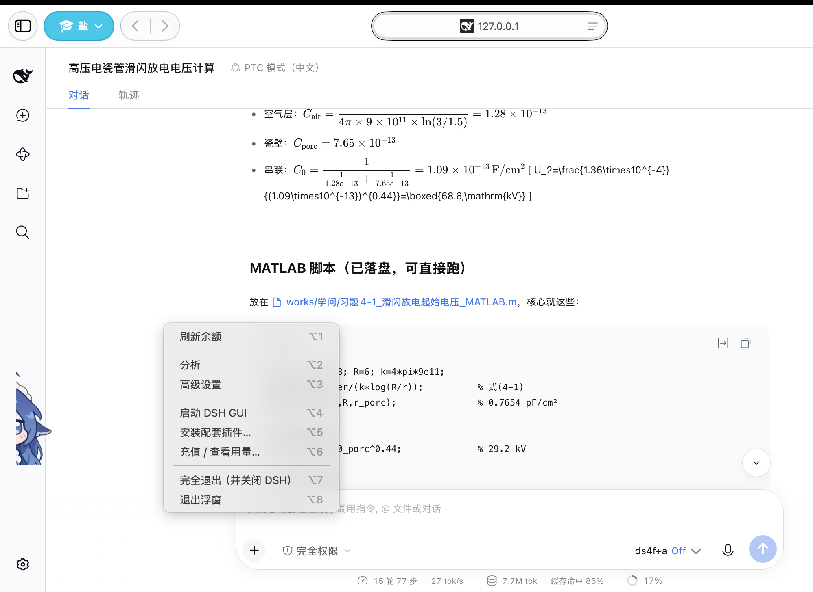

# WhaleFloat

> **DSH 的 macOS 启动器** —— 一键起 GUI、挂了自动拉起来、插件装好、
> 顺带养了一只盯着余额的小鲸鱼。



它不是一个「桌面挂件」，而是一个**把 DSH 跑起来并且跑稳**的应用程序。
桌宠只是它的一张脸。

---

## 一、它能做什么

### 1. 启动 DSH GUI（核心）

菜单栏点一下「启动 DSH GUI」，程序会：

```
· 静默执行启动器脚本（不弹终端窗口）
· 抓取认证 URL，直接打开浏览器
· DSH 已在跑 → 复用缓存的 URL，直接开页面（不会重启它）
· 端口被别的程序占用 → 把原因弹给你，而不是默默失败
· 重复点击 → 忽略，不会起出两个实例
```

启动器脚本**随包内置**，不依赖工作区路径 —— 换台机器或挪过目录也不会失效。

### 2. 守护进程

```
装好后由 launchd 托管，配置为「仅在异常退出时拉起」：
  · 程序崩了        → 自动重启
  · 你主动退出      → 不重启（不然关不掉）

首次运行时程序自己把 launchd 配置装好，你不需要跑任何脚本。
```

### 3. 插件安装

随包携带**三个** DSH 侧的中介插件，首次运行时**静默装好**（不弹框）：

| 插件 | 作用 |
|---|---|
| `dsh-wait-state` | DSH 等你回答 / 授权时，浮窗冒泡提醒 |
| `dsh-turn-usage` | 采集每轮消耗，供浮窗显示金额 |
| `dsh-notify-bridge` | 把回复推到系统通知，并支持在通知里直接回复 |

装好后自动注册进 DSH 的 web profile，不需要你手动改配置。

**菜单里还有一条「安装配套插件…」** —— 那是给手动补装用的，会弹框告诉你结果。

### 4. 余额与消耗监控

```
· 余额       直连 api.deepseek.com（读 ~/.dsh 下的凭据）
· 峰谷价     纯本地算，带节假日表
· 每轮消耗   从插件采集的账本读，逐轮明细
· 折线图     最近 N 轮趋势，X 轴按「时辰」对齐
```

**这部分不依赖 DSH 运行时** —— DSH 没开也能看余额。

### 5. 桌面桌宠

```
单击  → 冒一下余额气泡
双击  → 摸摸头（压扁拉宽 + 音效）
拖动  → 换位置；靠近屏幕边缘自动吸附并翻转朝向
```

角色素材需要自备（原因见「素材」一节）。

---

## 二、安装部署

### 方式一：手动（三步）

```bash
# 1. 下载 dmg（或从 Release 页面点下载）
curl -L -o /tmp/WhaleFloat.dmg \
  https://github.com/tigriyang/DeepSeek-Balance-Whale-Widget/releases/latest/download/WhaleFloat-0.1.1.dmg

# 2. 挂载并拷进应用程序目录
hdiutil attach /tmp/WhaleFloat.dmg -nobrowse
cp -R "/Volumes/小鲸鱼/WhaleFloat.app" /Applications/
hdiutil detach "/Volumes/小鲸鱼"

# 3. 启动（首次会自己装 launchd 自启）
open -a WhaleFloat
```

**或者更简单**：双击 dmg，把「小鲸鱼」拖进「应用程序」。

### 方式二：交给 AI 全自动部署

把下面这段整段复制给任意**有文件读写和命令执行能力**的 AI（Claude Code / Cursor / DSH 等）：

````markdown
帮我在这台 macOS 上安装 WhaleFloat（DSH 的启动器应用），按以下步骤执行，
每步做完确认结果再继续，遇到问题停下来说明原因：

1. 下载最新安装包：
   curl -L -o /tmp/WhaleFloat.dmg \
     https://github.com/tigriyang/DeepSeek-Balance-Whale-Widget/releases/latest/download/WhaleFloat-0.1.1.dmg

2. 挂载：hdiutil attach /tmp/WhaleFloat.dmg -nobrowse
   记下挂载点（通常是 /Volumes/小鲸鱼）

3. 把 WhaleFloat.app 从挂载点复制到 /Applications/（已存在就替换）

4. 卸载镜像并清理：hdiutil detach <挂载点>; rm -f /tmp/WhaleFloat.dmg

5. 启动它：open -a WhaleFloat
   （首次运行它会自己安装 launchd 自启配置，并静默装好三个配套插件）

6. 验证：
   · ps -axo command= | grep WhaleFloat  → 应有进程
   · 菜单栏应出现一个小鱼图标
   · ls ~/Library/LaunchAgents/ai.dsh.whalefloat.plist → 应存在

7. 如果 DSH 尚未安装，提醒我，不要擅自安装。

注意：不要用 sudo，全程在用户目录下操作。
````

### 卸载

```bash
bash uninstall.sh            # 清掉本体 + 自启 + 插件 + 设置 + 缓存，共 7 类痕迹
bash uninstall.sh --keep-data  # 想保留设置和导入的角色时才加参数
```

---

## 三、架构与 fork 关系

### 组成

```
WhaleFloat.app                Swift + AppKit 原生程序
├── 启动器      内置 dsh-launcher.sh，负责起 DSH 并抓认证 URL
├── 守护        launchd 配置（首次运行自动安装）
├── 状态栏图标  菜单唯一入口
├── 桌宠        NSWindow 浮窗，角色 + 气泡分层绘制
└── docs/images 界面截图

外部：
├── dsh-wait-state     DSH 插件：上报「等回答 / 等授权」状态
├── dsh-turn-usage     DSH 插件：采集每轮 token 与金额
└── dsh-notify-bridge  DSH 插件：把回复推到系统通知，并接收通知里的回复
```

**为什么需要那三个插件**：DSH 的事件只有它自己知道，
插件在 DSH 进程内监听后写成文件，本程序读文件 —— 两边解耦，
DSH 没开时程序照常工作（只是少了实时数据）。

### 数据流

```
余额     WhaleFloat ──直连──▶ api.deepseek.com     （不经 DSH）
峰谷     WhaleFloat ──本地计算──▶ 节假日表
每轮消耗  DSH ──插件──▶ ~/.dsh/.whalefloat-usage.json ──▶ WhaleFloat
等待状态  DSH ──插件──▶ ~/.dsh/.whalefloat-wait.json  ──▶ WhaleFloat
```

### 与上游的关系

**本仓库是 [MeteorNOX/DeepSeek-Balance-Whale-Widget](https://github.com/MeteorNOX/DeepSeek-Balance-Whale-Widget)
的 fork** —— 一次**移植**，不是重写。

| | 上游 | 本项目 |
|---|---|---|
| 形态 | DSH 网页插件 | 独立 macOS 程序 |
| 语言 | JavaScript | Swift + AppKit |
| idea / 交互设计 / 美术素材 | **原创** | **继承自上游** |
| 代码 | —— | 按 Swift 重写，无 JS 复用 |
| 账本格式 | —— | **保持兼容**，历史数据无需转换 |

**为什么保留 fork 关系**：角色立绘、音效、交互节奏都来自上游，
这是做这次移植的前提。用 fork 而不是另建仓库，是为了让这份继承
关系在 GitHub 上始终可见 —— **语言变了，源头没变**。

上游代码已从本分支移除，仓库里只有 Swift 实现。

### 素材

**本仓库不含角色立绘与音效。**

上游的 `PROVENANCE.md` 明确划分：**代码是 MIT，但 `assets/` 不在 MIT 覆盖内** ——
原文是「按 as-is 随插件分发，**仅用于运行本插件；不授予再许可**」。

所以这里排除。你可以：

1. 菜单 → 高级设置 → **「获取角色素材…」**（会打开素材文件夹 + 上游页面）
2. 自己下载后放进 `~/.dsh/whalefloat-assets/`
3. 回来点 **「导入角色图片…」**

缺素材时程序仍可用 —— 退化为「仅状态栏图标」模式，功能一个不少。

---

## 四、界面

### 菜单面板


### 分析页


---

## 许可

本项目代码按 **MIT** 发布（见 [LICENSE](LICENSE)）。
角色立绘与音效不在本仓库，也不在 MIT 覆盖范围内。

如上游作者对本仓库的移植方式有异议，请提 issue，我会立即调整或移除。

## 名称

**WhaleFloat** 是本项目的名称，首次公开发布于 2026 年。
时间证据可见本仓库的提交历史（每条都带时间戳与作者）。